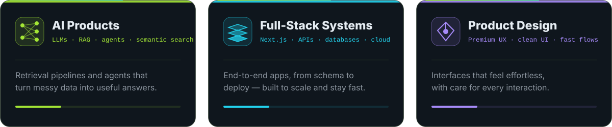

 

  

<!-- ───────────────────────── 01 · ABOUT ───────────────────────── -->
<picture>
  <source media="(prefers-color-scheme: light)" srcset="assets/title-about-light.svg" />
  
</picture>

  

<!-- ───────────────────────── 02 · WHAT I BUILD ───────────────────────── -->
<picture>
  <source media="(prefers-color-scheme: light)" srcset="assets/title-work-light.svg" />
  
</picture>

  

<!-- ───────────────────────── 03 · FEATURED BUILDS ───────────────────────── -->
<picture>
  <source media="(prefers-color-scheme: light)" srcset="assets/title-projects-light.svg" />
  
</picture>

  

<!-- ───────────────────────── 04 · GITHUB DASHBOARD ───────────────────────── -->
<picture>
  <source media="(prefers-color-scheme: light)" srcset="assets/title-dashboard-light.svg" />
  
</picture>

<!-- 3D contribution city — generated daily by .github/workflows/profile-3d.yml -->

  

  

<!-- ───────────────────────── 05 · TECH STACK ───────────────────────── -->
<picture>
  <source media="(prefers-color-scheme: light)" srcset="assets/title-stack-light.svg" />
  
</picture>

<b><code>LANGUAGES</code></b> 

<b><code>FRONTEND &amp; DESIGN</code></b> 

<b><code>BACKEND &amp; DATA</code></b> 

<b><code>AI / ML</code></b> 

<b><code>CLOUD &amp; TOOLING</code></b> 

  

<!-- ───────────────────────── 06 · SNAKE ───────────────────────── -->
<picture>
  <source media="(prefers-color-scheme: light)" srcset="assets/title-snake-light.svg" />
  
</picture>

<picture>
  <source media="(prefers-color-scheme: dark)" srcset="https://raw.githubusercontent.com/ADVRMA/ADVRMA/output/snake-dark.svg" />
  <source media="(prefers-color-scheme: light)" srcset="https://raw.githubusercontent.com/ADVRMA/ADVRMA/output/snake-light.svg" />
  
</picture>

  

<!-- ───────────────────────── 07 · CONNECT ───────────────────────── -->
<picture>
  <source media="(prefers-color-scheme: light)" srcset="assets/title-connect-light.svg" />
  
</picture>

  

