<!-- ─────────────── 01 · ABOUT ─────────────── -->
<picture>
  <source media="(prefers-color-scheme: light)" srcset="assets/title-about-light.svg" />
  
</picture>

<!-- ─────────────── 02 · FEATURED BUILDS ─────────────── -->
<picture>
  <source media="(prefers-color-scheme: light)" srcset="assets/title-projects-light.svg" />
  
</picture>

<!-- ─────────────── 03 · GITHUB DASHBOARD (rebuilt by .github/workflows/snake.yml) ─────────────── -->
<picture>
  <source media="(prefers-color-scheme: light)" srcset="assets/title-dashboard-light.svg" />
  
</picture>

<picture>
  <source media="(prefers-color-scheme: light)" srcset="https://raw.githubusercontent.com/ADVRMA/ADVRMA/output/snake-light.svg" />
  
</picture>

<!-- ─────────────── 04 · TECH STACK ─────────────── -->
<picture>
  <source media="(prefers-color-scheme: light)" srcset="assets/title-stack-light.svg" />
  
</picture>

<!-- ─────────────── 05 · CONNECT ─────────────── -->
<picture>
  <source media="(prefers-color-scheme: light)" srcset="assets/title-connect-light.svg" />
  
</picture>

